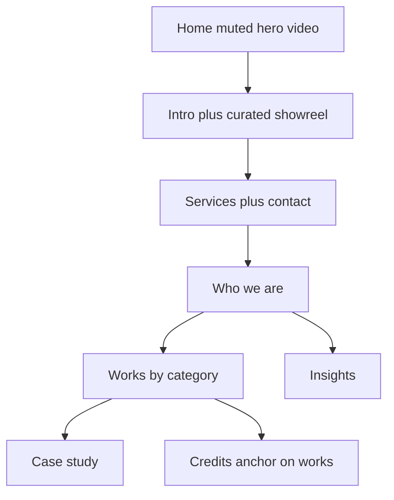

# Jekyll theme for BubbleFish Studio

## Design thesis

Keep the **light, quiet gallery** of the live site. Borrow the **professional skeleton** of [Native Darkness](https://www.nativedarkness.com/) and [Flutu](https://flutumusic.com/), not their agency tone or dark game-audio look.

- Light warm paper background, charcoal type, lots of air
- **Full-width sections** stacked like a studio reel, not a centered blog column
- Home opens on a **muted looping background video** plus one short line; the next section is a **curated showreel with audio** (not a grid of works)
- Work lives on `/works`, grouped by category, with the full credit list at the bottom
- Intimate scale: two people, headshots on the home page, Milano / Hangzhou




## What to take from each source

**Live site (content)**  
Home intro *Exploring Beauty in Sounds*. Work set: Interwoven Realms, The Scarlet Monster, The Purple Rain, Inheritance, Museum Memories, Taste of Pinot, Do You Hear The Wind?, AlphaXmas, Meldy, plus other soundtracks / video assets. Credits grouped as Short Films, Exhibitions, Video Games (shown on the works page, not as its own nav item). Footer VAT `IT16567861006`. Email `info@bubblefish.studio`. Socials: GitHub, LinkedIn, Behance, YouTube, Instagram, Spotify.

**This repo (keep only what still helps)**  
Geometric logo SVG in `[_includes/header.html](_includes/header.html)`, GitHub Pages deploy in `[.github/workflows/deploy.yml](.github/workflows/deploy.yml)`, CNAME `bubblefish.studio`, existing markdown for older works as drafts to **rewrite against live copy**. Drop Bootstrap, Font Awesome, EN/IT URLs, the About page, and the student-era intro on `[contents/_pages/en/works.md](contents/_pages/en/works.md)`.

**References (structure only)**  

- Native Darkness: services + contact as a first-class pair, media before text  
- Flutu: full-bleed hero video, a dedicated Listen/showreel moment, one sticky CTA

## Information architecture (English only)

Nav: **Works**, **Insights**, and a **Contact** control (mailto or in-page `#contact`). No About. No Credits in the nav.

- `/` — hero, intro + showreel, services + contact, who we are
- `/works` — selected works by category; credits list at `#credits`
- `/works/:slug` — case study
- `/insights` — essay list
- `/insights/:slug` — post
- `/papers` — optional, not in nav (live still has it)

Redirects (preserve live and old-repo links):

- `/credits` and `/credits/` → `/works#credits`
- `/about` and `/about/` → `/#who-we-are`
- `/en/*` and `/it/*` → English equivalents

## Visual system

Custom SCSS, no Bootstrap. CSS variables in one tokens file.

- **Surface:** off-white `#F6F5F2`, header bar `#F1F0ED`, ink `#1A1A1A`, muted `#6B6B6B`, hairline borders
- **Titles:** [Source Serif 4](https://fonts.google.com/specimen/Source+Serif+4) (Google Fonts), used for page titles, section headings, work titles
- **Body / UI:** Helvetica stack, no extra sans webfont: `"Helvetica Neue", Helvetica, Arial, sans-serif` (native on macOS/iOS; Arial fallback elsewhere)
- **Layout:** 12-column fluid grid, section padding `clamp`, full-bleed media
- **Motion:** muted autoplay on the hero; showreel plays with audio only after a user gesture (or an explicit play control). Honor `prefers-reduced-motion`
- **Logo:** keep the existing mark; keep the header as quiet as the live site

## Jekyll architecture (from scratch)

- **Jekyll + `github-pages` gem**. Bump CI Ruby from 2.6 to **3.2** in `[.github/workflows/deploy.yml](.github/workflows/deploy.yml)`
- Collections: `works`, `insights`. Static pages in `_pages/` (no `contents/_pages/en|it`)
- Layouts: `default`, `home`, `works`, `project`, `insights`, `post` — **no** `about` or `credits` layouts
- Includes: `hero-video`, `showreel`, `work-card`, `embed-vimeo`, `embed-audio`, `section`, `cta`, `person`
- Data: `_data/nav.yml`, `_data/social.yml`, `_data/credits.yml`, `_data/services.yml`, `_data/people.yml` (headshots + short bios)

**Work front matter:**

```yaml
title: Taste of Pinot
summary: Enrich an anniversary exhibition with an acousmatic installation
year: 2021
category: exhibitions   # animations | exhibitions | short-film | computational | ...
location: Venice, Italy
thumbnail: /assets/works/taste-of-pinot/thumb.jpg
hero: /assets/works/taste-of-pinot/hero.jpg
video:
audio:
selected: true          # appears in the categorized works grid
```

Markdown body stays free-form for long case studies.

**Two distinct home videos** (neither is in this repo today; you supply the files):

1. Hero loop — compressed muted MP4 + poster in `assets/video/`, GitHub 100MB cap
2. Curated showreel — one video **with audio** that showcases all works; native `<video controls>` or Vimeo, never autoplay-with-sound

## Page-by-page

**Home**

1. Full-width **background video** (muted, looping) + one short line
2. Intro text (*Exploring Beauty in Sounds* and the live studio paragraph) **plus one curated showreel with audio**. No work grid on home
3. **Services** (composition & sound design, acousmatic / site-specific, generative & computational, research) **and a contact button** (`mailto:info@bubblefish.studio` or `#contact`)
4. **Who we are:** Yilin and Matteo headshots + short bios (this replaces the About page)

**Works index**

- Grid of **selected** works, **separated by category** (animations, exhibitions, short-film, and any others you define in front matter)
- **Full credit list at the bottom**, `id="credits"`, sourced from `_data/credits.yml` (live Short Films / Exhibitions / Video Games lists)
- `/credits` redirects here via the credits anchor

**Case study**  
Unchanged: full-bleed still or video, then a narrower text column, then full-width image/embed sections. Metadata: year · category · place · collaborators.

**About**  
**Deleted.** Bios and headshots live on home (`/#who-we-are`). `/about` redirects there.

**Insights**  
Unchanged: diary tone, simple list, not a magazine. Migrate live posts missing from this repo (Synesthesia, game music, library music, profitable artist).

## Content migration

Treat live as canonical. This repo’s works are incomplete and some titles differ (e.g. live “Taste of Pinot” vs repo “Off The Skins”).

1. Inventory live pages and download images/video you own (hero loop, showreel, headshots)
2. Recreate each selected work as markdown + local assets, with a `category`
3. Port insights; drop Italian duplicates
4. Port credit lists into YAML
5. Rewrite in the new theme; do not scrape the current CMS CSS

## Contact and hosting

- Contact button: `mailto:info@bubblefish.studio`. Optional later: Formspree/Basin (GitHub Pages has no backend)
- Deploy `_site` to `gh-pages` with `CNAME` `bubblefish.studio`
- Cutover: point DNS at GitHub Pages when ready; current live host stays until then
- SEO: unique titles, Open Graph images, `sitemap.xml`

## Explicitly out of scope (unless you ask)

- Dark theme, testimonials, lead magnets, Italian UI
- Home works grid, standalone About page, standalone Credits page
- Reusing Bootstrap / Font Awesome
- Recreating the live site’s search widget

## Build order

1. Empty the old theme; new `_config.yml`, layouts, type tokens, nav/footer
2. Home: hero placeholder, showreel placeholder, services + contact, who we are
3. Works index by category + `#credits` + one case study template (Taste of Pinot)
4. Remaining selected works, insights, redirects (`/about`, `/credits`, `/en`, `/it`)
5. Meta, CI Ruby bump, local `bundle exec jekyll serve`
6. DNS cutover when you are happy with it

