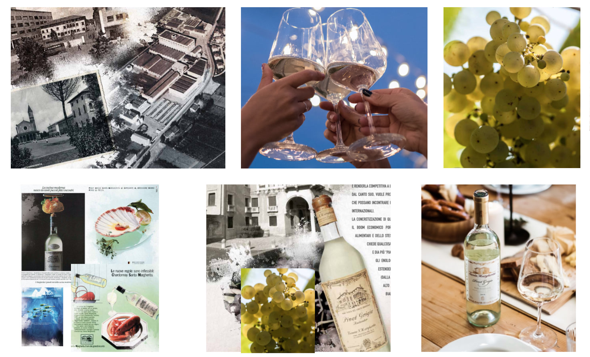
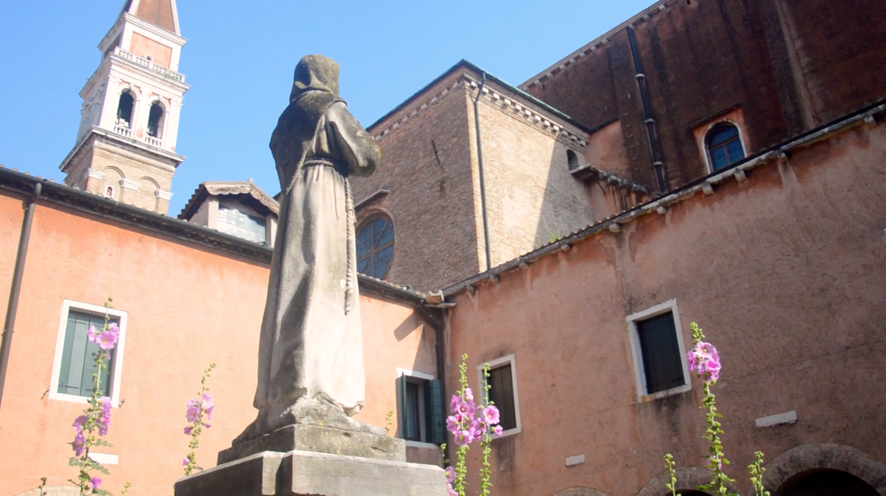
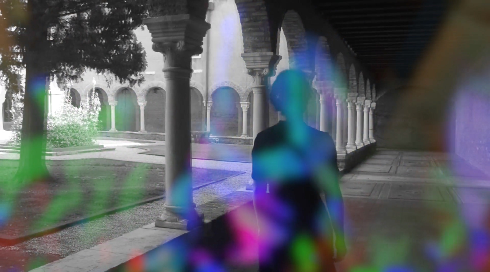
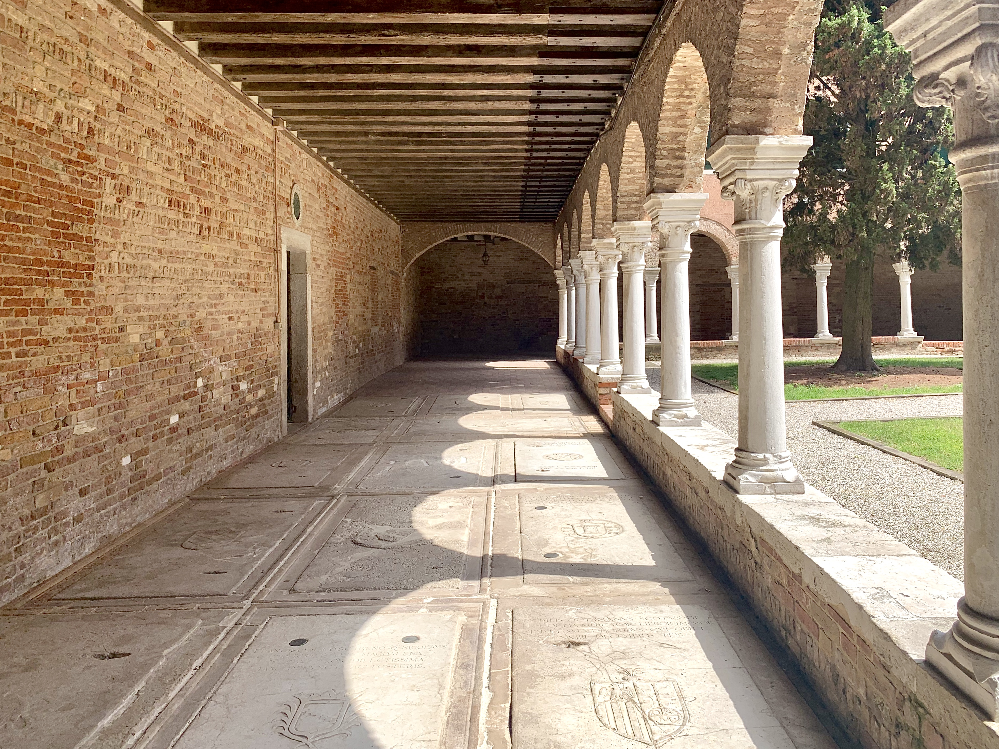
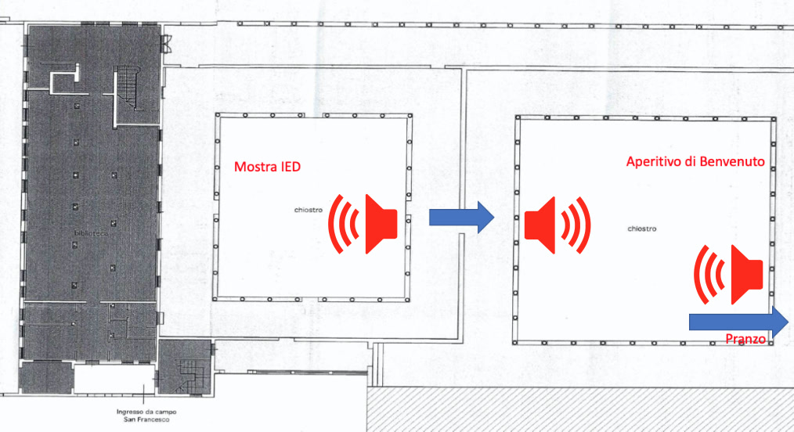
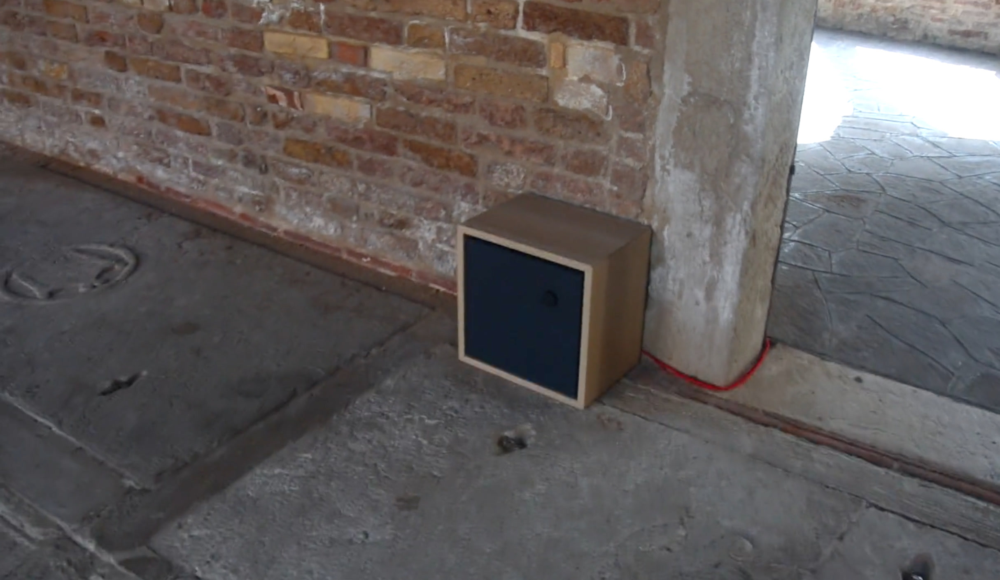

<iframe src="https://player.vimeo.com/video/591565838?h=37671d1c49&title=0&byline=0&portrait=0" width="640" height="360" frameborder="0" allow="autoplay; fullscreen; picture-in-picture" allowfullscreen></iframe>

## Introduction

This project is a site-specific composition of music and acoustic design for the 60th anniversary exhibition of the wine brand Pinot Grigio Santa Margherita. 

The event took place at the 16th century church S. Francesco Della Vigna, in Venice, Italy, which also includes a historical 500m² wine yard inside. According to the unique architecture of the two cloisters area, we designed a two-part soundtrack for this exhibition event, in order to give a continue sense of the space for the guests to follow.

The two parts have the same duration of 6:32 minutes. The second part consist of a layered-up version of the first one, with more dynamics and rhythmic details. The transition between the two is continue and smooth for the audience, creating an extra sense of comfort and relaxing atmosphere.

## Continuity of the space

The two cloisters have their own function during the exhibition event: the first cloister serves as exhibition hall for 20 graphical installations, while the second serves as an aperitivo area for media guests and press. The external grass garden is finally used as lunch area.

After analysing the environment, we focused on the idea of letting the soundtrack itself to be the guide and connection between the whole exhibition space separated by a corridor between the two cloisters.

## Sound as a guidance

The two parts of the music piece are obtained as combination of layers. According to the actual position of the audience, different sounds being played can be heard. We set three speaker locations: the first layer is played at speaker locations no. 1 and no. 2, while, simultaneously, the second layer is played at speaker location no. 3.

The obtained effect is that the audience in the exhibition cloister can hear the same music as soundtrack no. 1, while the audience staying in the aperitivo cloister can hear the soundtrack no. 2, which is the combination of the first and second layers being played simultaneously.

We composed this music and sound design to let the audience hear the source of the music. Feeling the joint atmosphere created by the architectural space, graphical installations and music, they will automatically follow the direction of the music source, walking towards the right direction from the entrance to the exit corridor and then continue to the aperitivo area in the second cloister.

Finally, according to the site reverberation, noise and acoustic conditions, we prepared a suitable mixing for these tracks and used them during the exhibition period in June, 2021.

---
- Exhibition Time: *June 23rd to 29th, 2021*
- Location: *Venice, Italy*
- Concept: *Yilin Zhu, Chiara Isadora Artico*
- Music & Sound Design: *Yilin Zhu, Matteo Bernardini*
- Photo Report: *Yilin Zhu, Matteo Bernardini*
